# Oncall color proposals

Seven treatments of the same page, typography, and layout. The active site remains on **Oxide**. Each preview is a real browser capture at 1440 × 1060, with reduced motion enabled for a consistent still image.

Open **[the comparison gallery](index.html)** in a browser for larger side-by-side previews, or use the images below. Click a preview to see it at full size.

## 01 · Oxide — the current direction

Chalk, charcoal, and a red-pencil accent. Warm but restrained; an engineering notebook rather than a dashboard.

Light: `#f5f4f0` paper · `#292724` ink · `#983d22` accent  
Dark: `#171716` paper · `#eeece5` ink · `#dfa17d` accent

| Light | Dark |
| --- | --- |
| [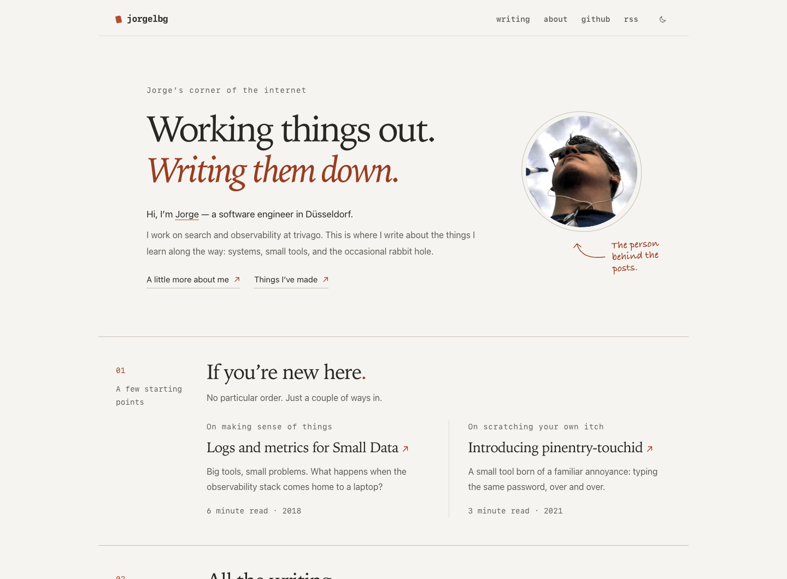](oxide-light.png) | [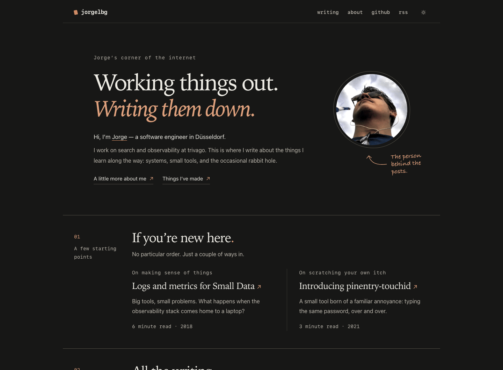](oxide-dark.png) |

## 02 · Oxblood — bookish and personal

Warm book paper with burgundy ink. Less technical, more literary; works especially well with the serif headings and handwritten marginalia.

Light: `#f8f4ed` paper · `#32292b` ink · `#833646` accent  
Dark: `#1b1719` paper · `#eee7e7` ink · `#dbaab3` accent

| Light | Dark |
| --- | --- |
| [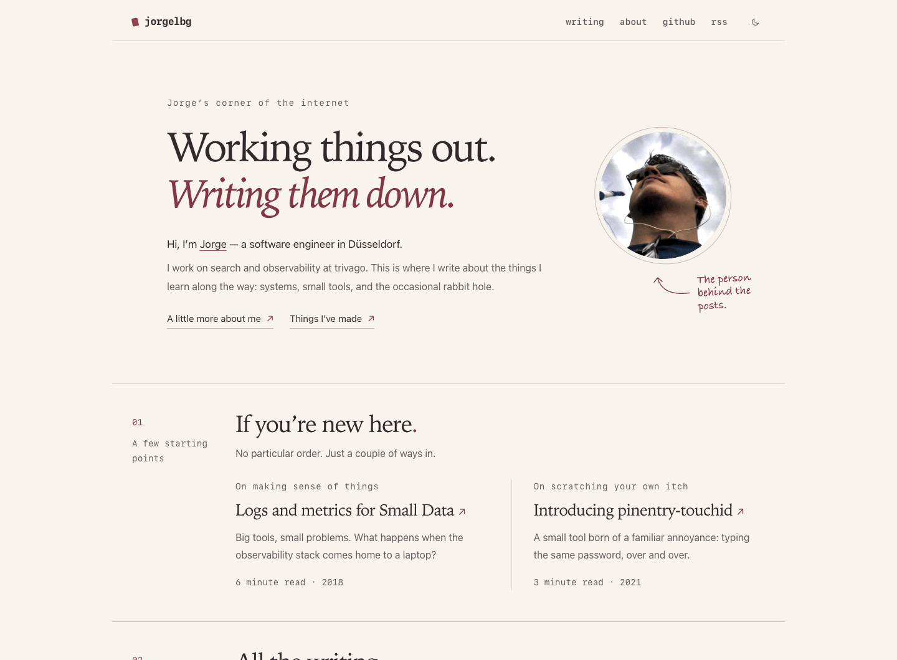](oxblood-light.png) | [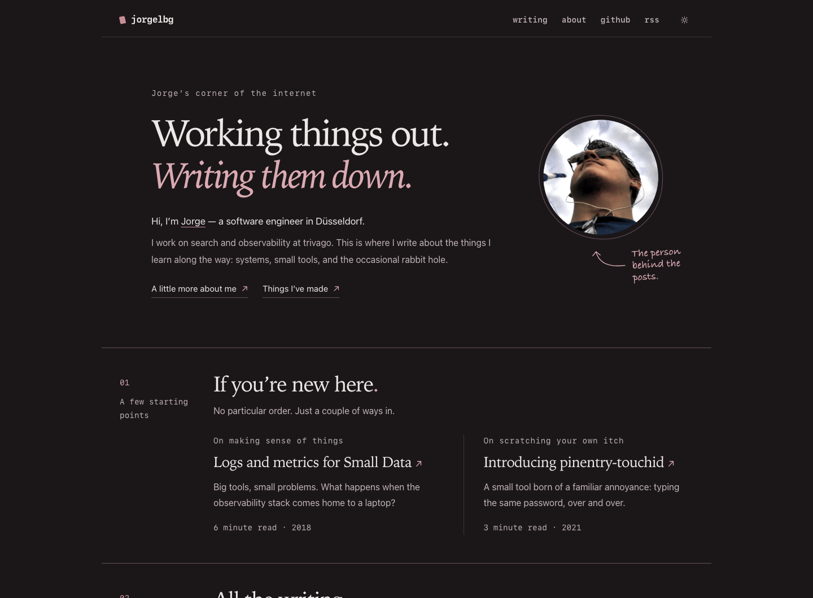](oxblood-dark.png) |

## 03 · Olive — a field journal

Limestone and moss, without mint or emerald. Quiet, tactile, and a little outdoorsy. The most distinct departure from typical software-blog colors.

Light: `#f4f3eb` paper · `#303328` ink · `#46522c` accent  
Dark: `#191c16` paper · `#e8ecdf` ink · `#c2cca0` accent

| Light | Dark |
| --- | --- |
| [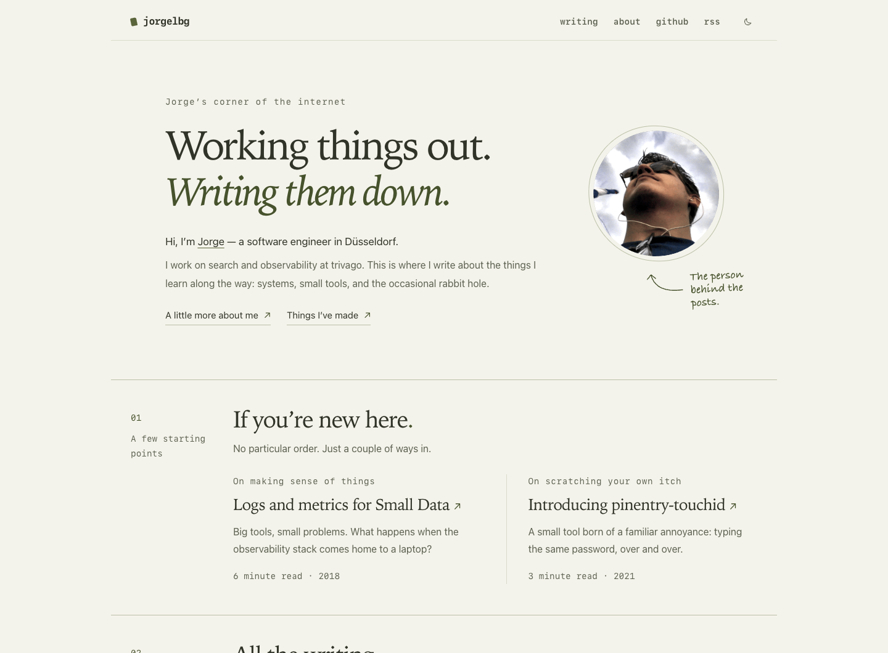](olive-light.png) | [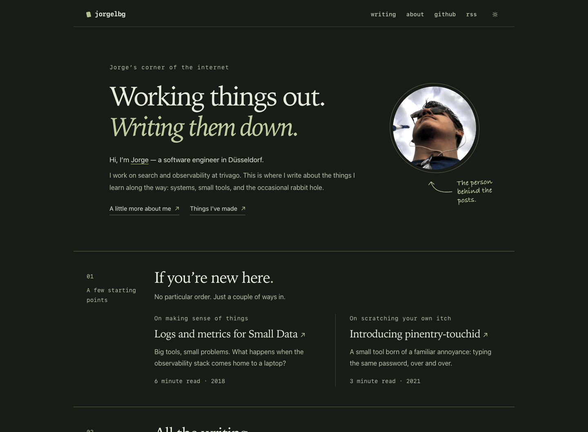](olive-dark.png) |

## 04 · Slate blue — fountain-pen ink

Cool gray paper and faded blue ink, not electric blue or navy-and-teal. The most neutral, technical option, with a print-like feel.

Light: `#f3f4f3` paper · `#2b3136` ink · `#3d526b` accent  
Dark: `#181d21` paper · `#e6ecf0` ink · `#b0c2d4` accent

| Light | Dark |
| --- | --- |
| [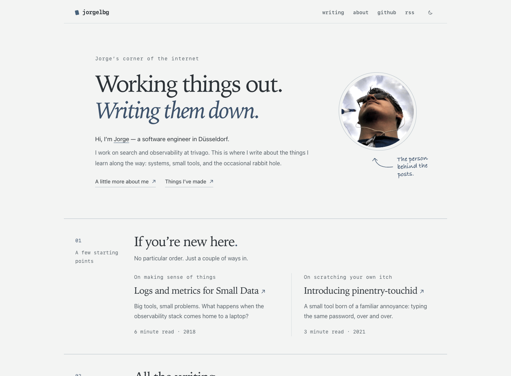](slate-blue-light.png) | [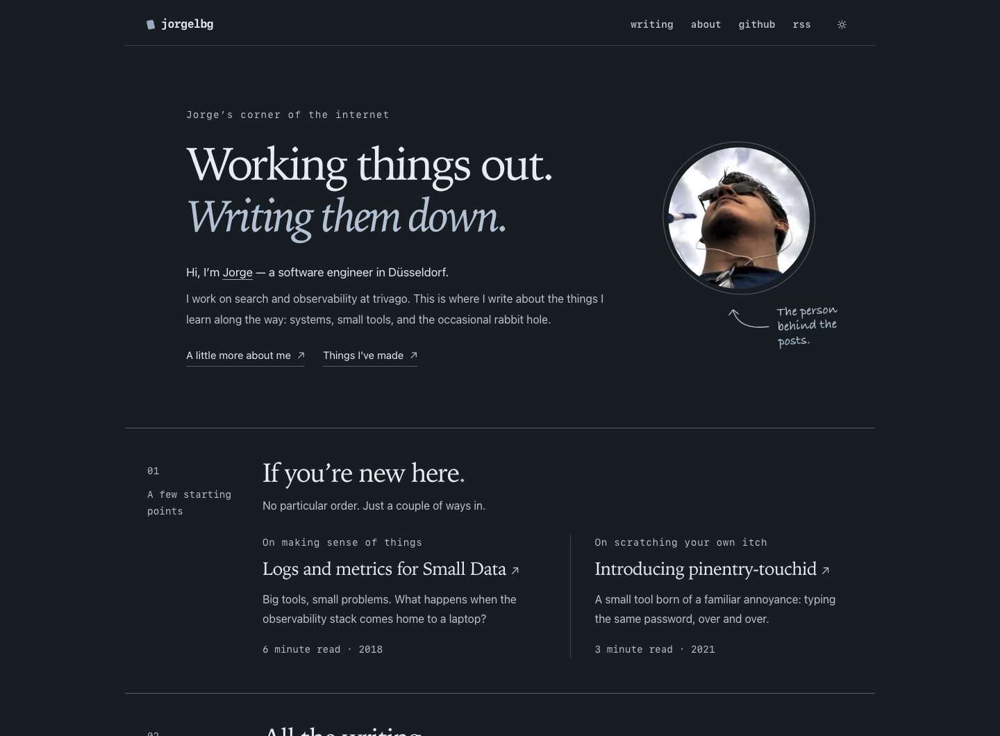](slate-blue-dark.png) |

## 05 · Ochre — a sun-faded print studio

Ivory stock, dark umber, and golden-brown ink. A warmer, brighter direction, with aged brass rather than saturated yellow.

Light: `#f8f5e9` paper · `#352e23` ink · `#79520f` accent  
Dark: `#1d1b16` paper · `#f1ead7` ink · `#e0c584` accent

| Light | Dark |
| --- | --- |
| [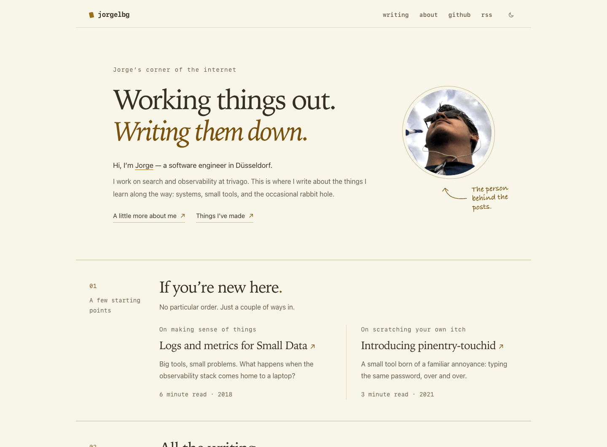](ochre-light.png) | [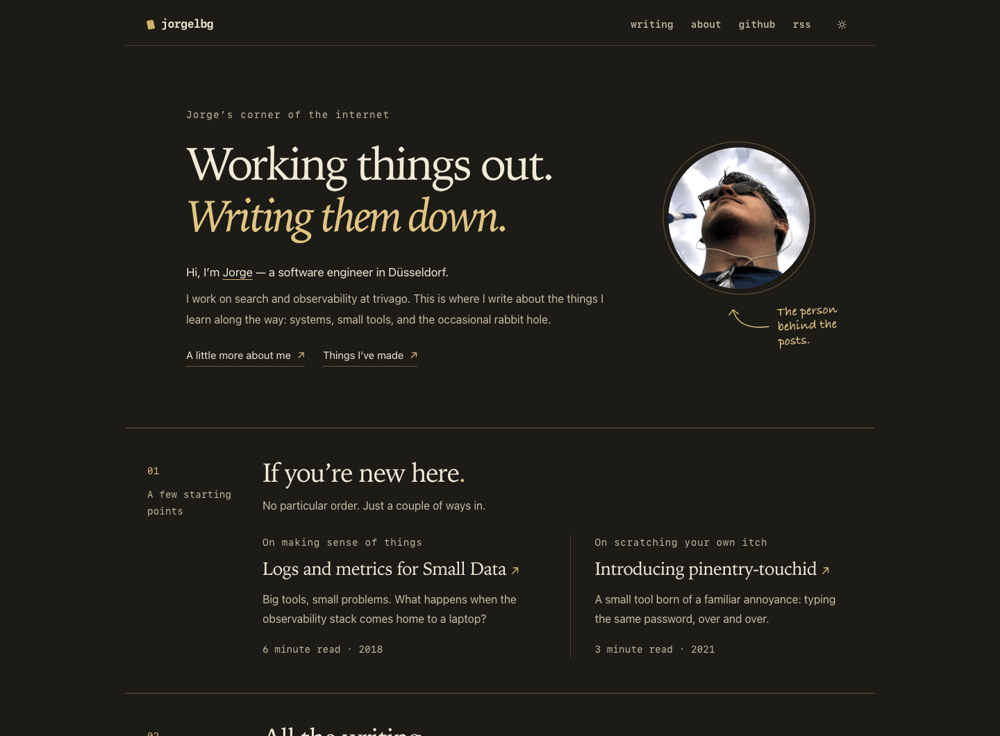](ochre-dark.png) |

## 06 · Aubergine — pearl and plum

A cooler, slightly unconventional direction. Muted plum ink and dusty lilac in dark mode, without neon purple or gradients.

Light: `#f5f2f4` paper · `#332c38` ink · `#654169` accent  
Dark: `#1d1920` paper · `#eee7f1` ink · `#d0b4dc` accent

| Light | Dark |
| --- | --- |
| [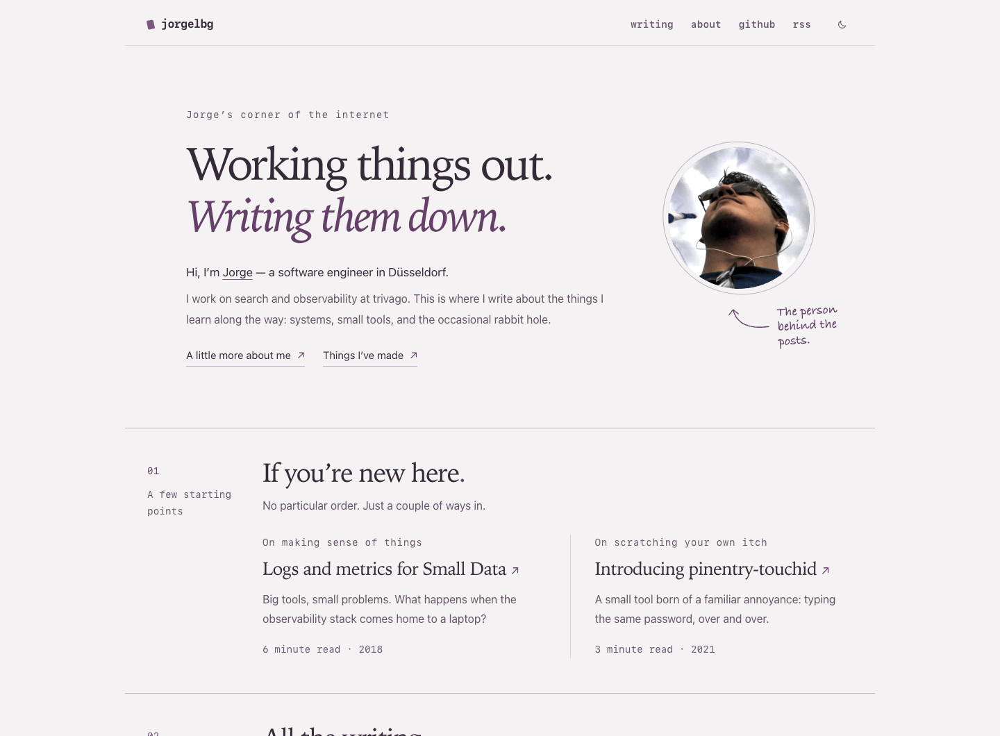](aubergine-light.png) | [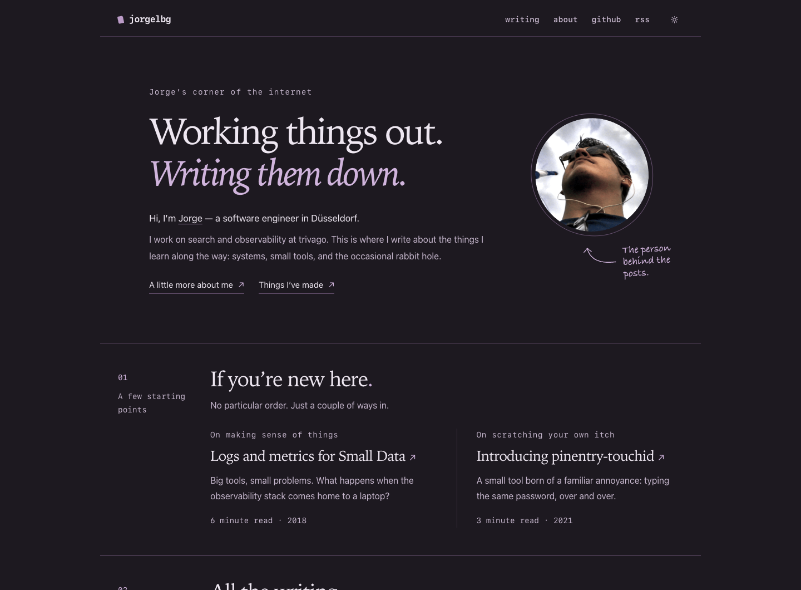](aubergine-dark.png) |

## 07 · Espresso — nearly monochrome

Parchment and coffee ink with sepia annotations. The quietest, warmest option, with the emphasis on typography rather than accent color.

Light: `#f3eee6` paper · `#352d27` ink · `#65472f` accent  
Dark: `#201b18` paper · `#efe6d9` ink · `#dbbb96` accent

| Light | Dark |
| --- | --- |
| [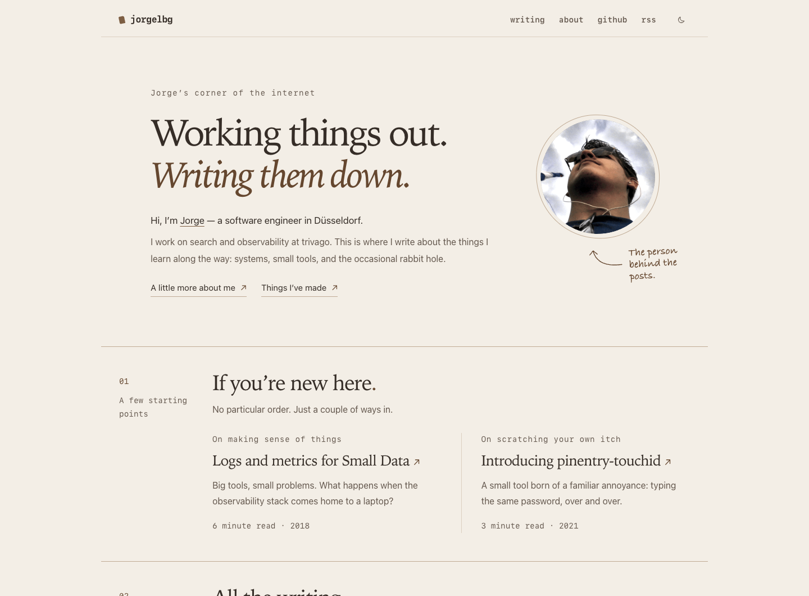](espresso-light.png) | [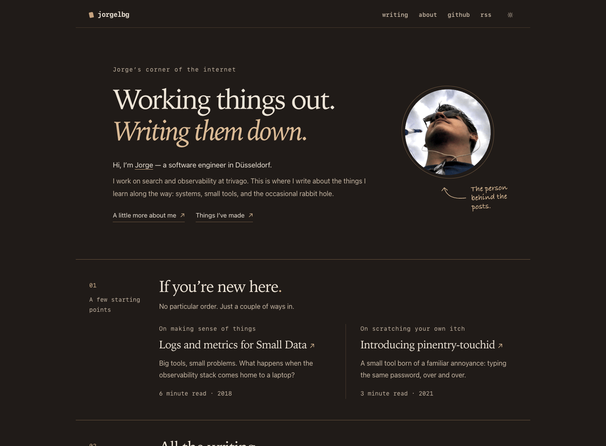](espresso-dark.png) |

## Try a palette on the site

Each proposal is an optional stylesheet in `themes/oncall/static/css/palettes/`. Choose **one** in the existing `[params]` section of `config.toml`:

```toml
customCSS = ["css/palettes/oxblood.css"]
```

Available files: `oxide.css`, `oxblood.css`, `olive.css`, `slate-blue.css`, `ochre.css`, `aubergine.css`, `espresso.css`.

Then run:

```sh
hugo server --theme oncall --port 1315
```

The theme's existing light/dark toggle and system preference work with every palette. Set `customCSS = []` to return to the default. No new JavaScript or dependencies are added to the site.

These stylesheets change the page-color tokens, including borders, status colors, and shadows; the shared, muted syntax-highlighting palette stays the same to keep the comparison focused. The screenshots and gallery are documentation, not site content.

## Validation

- All seven palettes build with Hugo.
- Primary, secondary, muted, accent-link, and status text tokens meet **4.5:1** contrast on paper, secondary paper, and card surfaces in both modes.
- Homepage checked at 1440px, 390px, and 320px with no horizontal overflow.
- Light/dark toggle checked for every proposal.
